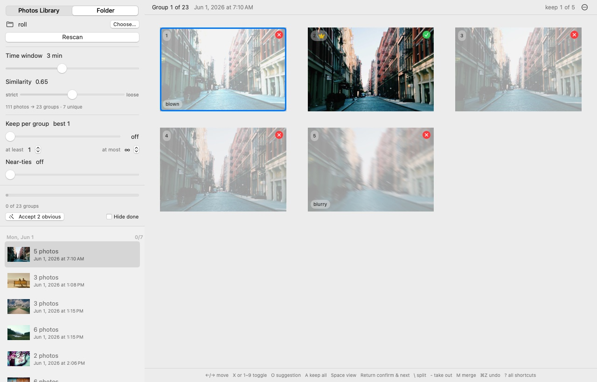
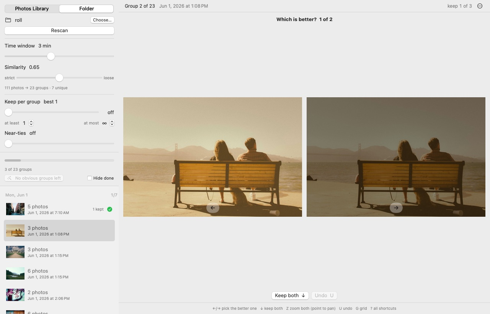
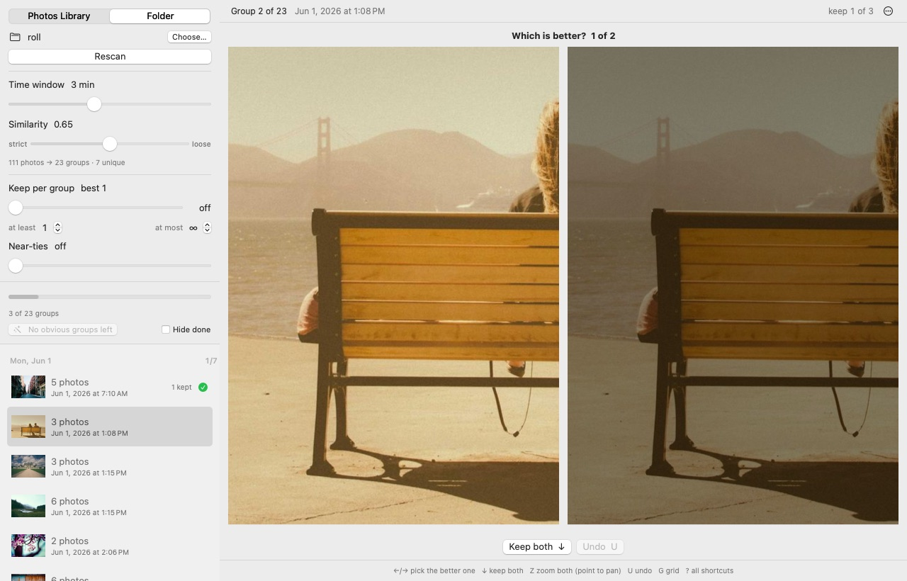
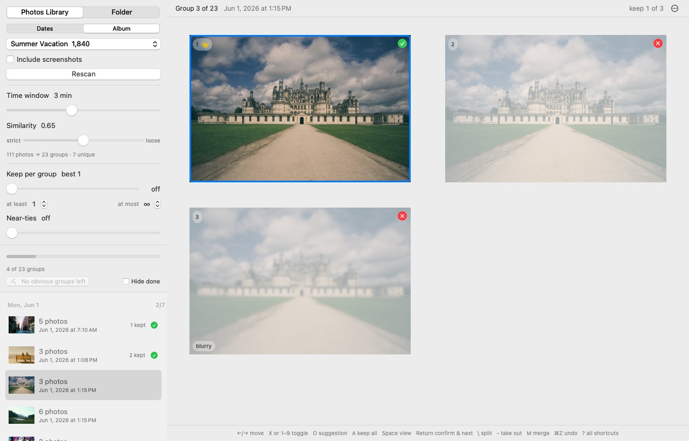
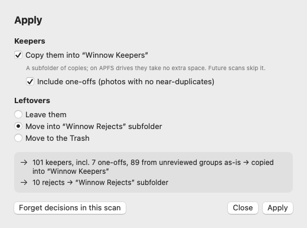
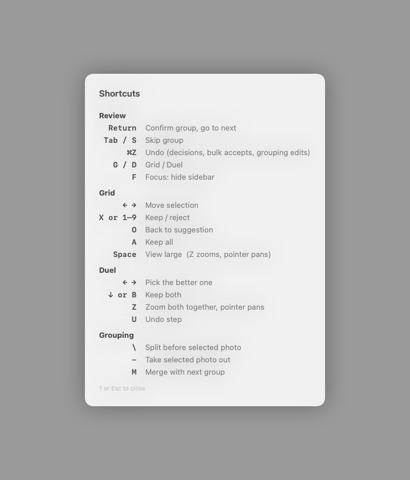

# Winnow

> **Heads up: this app is 100% vibe coded.** I made this for myself since I always take 10-20 duplicate bursts of photos. Seems to work! At least enough for me to actually clean up my years of old albums. YMMV!

Clear out near-duplicate shots from your Photos library (or any folder of images), keeping the best
one or few from each burst. Built for working through big backlogs, like a trip's worth of photos, quickly.

## Tour

Scan a folder or a Photos date range or album. Each group of near-duplicates opens with the suggested keeper
(crown) already kept and the rest marked, tagged with what's wrong with them. Fix anything that looks off,
press `Return`, and move on to the next group.

For close calls, **Duel** (`D`) shows two frames side by side. `Z` zooms both together so you can compare detail.

The Photos source can scan a date range or a single album:

When you're done, or partway through, **Apply…** shows exactly what will happen before anything does:

Everything has a key; `?` lists them all.

*Screenshots use a synthetic camera roll made by `WinnowCheck gen` from [Lorem Picsum](https://picsum.photos)
(Unsplash) stock photos. The album names are placeholders.*

## Install

Build it yourself. You need macOS 15 or later and Apple's Command Line Tools (Swift 6.1 or later), not full Xcode:

    xcode-select --install        # skip if you already have them
    git clone https://github.com/zcross/winnow.git
    cd winnow
    ./build.sh install            # builds and copies Winnow.app to ~/Applications

It takes a minute or so. The app is signed locally (ad hoc), so macOS opens it without any Gatekeeper prompts.
It asks for Photos access the first time you scan your library; folders don't need it.
To update, `git pull` and run `./build.sh install` again.

Each macOS account has its own Photos permission, cache, and saved decisions (in
`~/Library/Application Support/Winnow`). Nothing leaves your Mac: all analysis runs on-device with Apple's Vision framework.

## How it works

1. **Scan** a date range of your Photos library, or a folder. Each photo gets:
   - a Vision feature print (what's in it),
   - a 16×16 colour layout signature (survives blur, shake, noise and exposure changes),
   - Apple's aesthetics score plus sharpness, clipping, brightness and grain measurements.

   Results are cached, so rescans are instant. About 3–6 ms per photo on Apple silicon.
2. **Group**: photos shot close in time that look alike are grouped. A botched retake (blurred,
   shaken, mis-exposed) seconds after a good frame joins it through the layout signature.
   The **Time window** and **Similarity** sliders regroup instantly.
3. **Pick**: the suggested keeper is the best aesthetics score after penalising frames that are
   blurrier, more blown out, darker or grainier *than their siblings*. Losing frames are tagged with why.
4. **Review**, keyboard first:
   - **Grid** (default): the pick is pre-kept. Glance, fix with `X` / `1–9`, press `Return`. One key per group.
   - **Duel** (`D`): best-so-far vs the next frame. `←`/`→` pick, `↓` keeps both. n photos take n−1 keys.
   - **Accept obvious**: one click accepts every group where the pick clearly wins (marked with a wand).
   - **Pick rules**: keep a clamped share of each group, ⌈percent × size⌉ between *at least* and *at most*
     (fixed N and plain percentages are special cases), optionally plus near-ties.
   - **Fix groups**: `\` splits before the selected photo, `-` takes it out, `M` merges with the next group.
     Edits are stored per photo, so they survive slider changes and rescans.
   - **Compare**: in Duel or the `Space` viewer, `Z` zooms 3× and the pointer pans, both duel photos together.
   - `⌘Z` undoes commits, bulk accepts and grouping edits. `F` hides the sidebar. `Tab` skips. `?` lists everything.
   - The sidebar groups the backlog by day, with progress and a time-left estimate at your pace.
5. **Apply…** is a small plan with a preview of exactly what will happen:
   - **Keepers**: put them in an album (named after the scanned album, e.g. "Summer Vacation · Keepers"; an album
     just points at photos already in your library), or for folders copy them into a `Winnow Keepers` subfolder,
     keeping their subfolder paths. On APFS drives (any Mac's internal disk) those copies take no extra space.
     Optionally include one-offs (photos with no near-duplicates) so it's the complete curated set; unreviewed
     groups go in as-is. Optionally favourite the picks.
   - **Leftovers**: leave them; collect them (a "Winnow Rejects" album or subfolder); remove them from the
     scanned album only (they stay in the library); or delete them (Photos asks first and keeps them in
     Recently Deleted for 30 days; folders go to the Trash with their RAW halves and sidecars).

**Albums**: scan one Photos album instead of a date range (Dates | Album). Albums also count as a
keep vote, but only an album that took *some* frames of a burst: a dump-the-whole-trip album says
nothing, while a "best of" album next to it makes its frames the suggested keepers (marked with an
album icon). Winnow's own "Winnow Rejects" album never counts.

**RAW+JPEG**: in Photos a pair is already one item (deleting removes both). In folders, files sharing a
name (`IMG_1.JPG` + `IMG_1.CR3`, plus `.xmp`/`.aae` sidecars) are treated as one photo: it's analysed via
the JPEG/HEIC, tagged `RAW+JPEG`, and moved or trashed as a set. RAW-only files are read through the
camera's embedded preview (a 6000px CR3: ~28 ms vs ~250 ms for a full RAW decode).

Decisions are saved as you go, so you can quit and pick up later.

## Development

    swift run WinnowCheck         # logic checks (swift test needs full Xcode)

### Validation without a Photos library

    swift run -c release WinnowCheck gen <stock-photos-dir> <out-dir> [rounds]   # synthetic camera roll
    swift run -c release WinnowCheck eval <out-dir>     # grouping + best-pick accuracy vs ground truth
    swift run -c release WinnowCheck bench              # clustering speed at 10k/50k photos
    swift build && WINNOW_DATA_DIR=/tmp/w .build/debug/Winnow --snapshot <out-dir> <png-dir>   # headless UI run + screenshots

`gen` turns each stock photo into bursts of good retakes (reframed, tilted, re-exposed) and flawed
ones (blurred, shaken, dark, blown, noisy), with sessions minutes to hours apart. On an 817-photo
roll from 38 stock photos: 227/228 groups exact with no false merges, and 149/153 picks are good frames.
The thresholds were tuned on this data, so expect real libraries to do a little worse.

`WINNOW_DATA_DIR` points the cache and decisions somewhere else, so dev runs never touch real ones.

## License

MIT, see [LICENSE](LICENSE).
